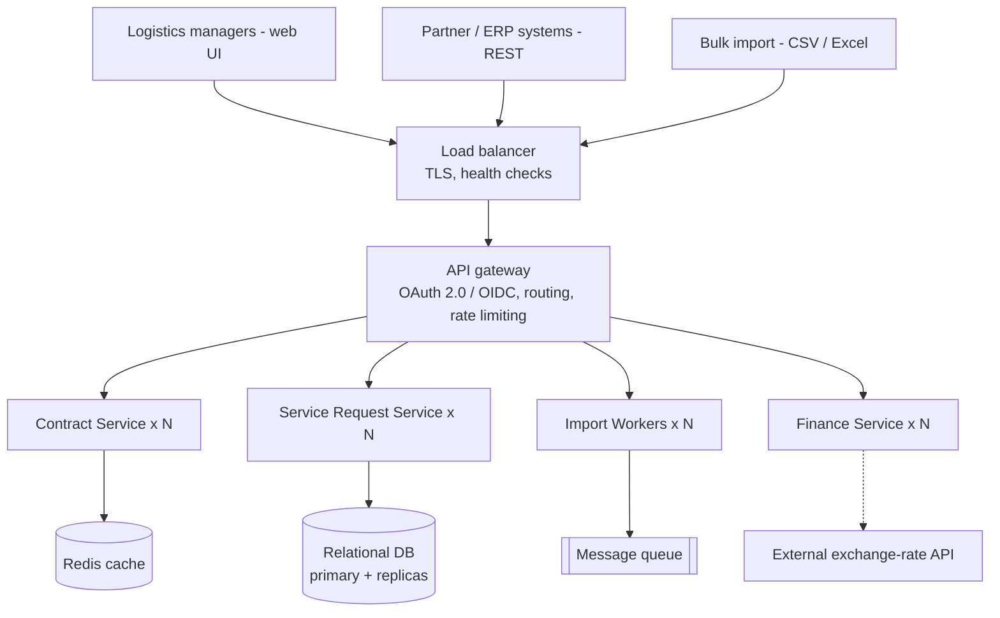

# GLMS Architecture

## 1. Framework: Zachman

Zachman organises one system into questions (What, How, Where) viewed from different perspectives. Part 1 completes the Planner and Designer rows; Parts 2 and 3 realise the lower rows as working software.

| | Data (What) | Function (How) | Network (Where) |
|---|---|---|---|
| **Planner** (scope) | Clients, contracts, SLAs, service requests, invoices, drivers, currencies and exchange rates | Manage contract lifecycle, raise service requests, schedule drivers, invoice in the client's currency, monitor SLA and compliance | TechMove head office, regional depots and ports, client offices, external exchange-rate provider |
| **Designer** (logical) | Client 1..* Contract; Contract 1 SLA; Contract 1..* ServiceRequest; Invoice stores amount, currency and rate used; status is Draft, Active, On Hold or Expired | Contract Service, Service Request Service (Active contracts only), Finance Service (conversion), status-change notifications | Web UI and partner REST APIs, load balancer, API gateway, containerised services, database with replicas and cache, HTTPS link to rate API |

## 2. Target architecture

## 3. Non-functional requirements

### Availability

- 99.9% monthly uptime for core functions (about 43 minutes of downtime a month)
- At least two instances of every service in separate availability zones, with health-checked load balancing
- Primary database with standby and automatic failover; RPO 5 minutes, RTO 30 minutes; backups restored in tests
- Graceful degradation: use the last cached exchange rate (time-stamped) if the rate API is down; timeouts, retries and circuit breakers

### Interoperability

- REST and JSON over HTTPS, documented with OpenAPI and versioned (`/api/v1`)
- OAuth 2.0 and OpenID Connect for authentication
- CSV and Excel import and export to migrate legacy spreadsheets; ISO 4217 currency codes and ISO 8601 UTC dates
- External systems isolated behind interfaces (Adapter pattern)

## 4. Scalability: 50,000 contracts overnight

| Strategy | How it helps |
|---|---|
| Asynchronous bulk ingestion | Import jobs go to a message queue and are processed in batches by workers; idempotent validation makes retries safe |
| Horizontal scaling | Stateless, containerised services scale out on CPU and queue depth |
| Load balancing | Least-connections balancing and health checks; gateway applies routing and rate limits |
| Caching | Redis holds contract status, SLA terms and exchange rates with a time-to-live |
| Database tuning | Read replicas, indexes on status, client and end date, partitioning of large tables by year |

**Trade-off:** caches and replicas are eventually consistent. Short time-to-live values and reading the primary database for critical checks (such as contract validation) limit the risk.

See `GLMS_Part1_Architecture_Report.pdf` for the full diagrams.
