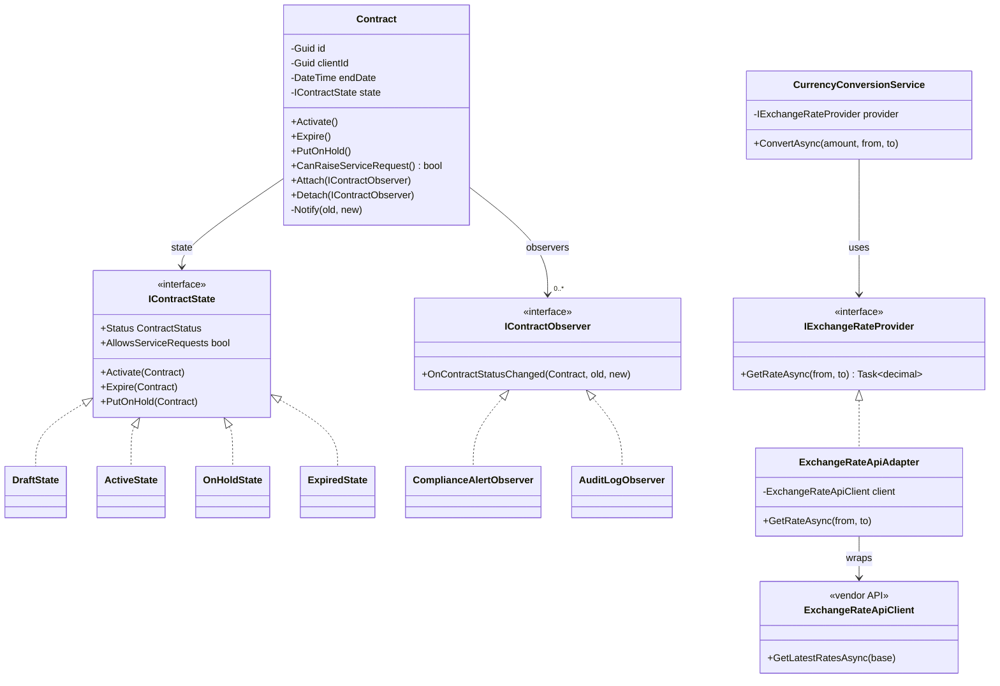

# Design Patterns in the GLMS

Three Gang of Four patterns are planned for the C# code. Each solves a specific problem from the brief.

## 1. State: contract lifecycle

**Problem:** behaviour depends on contract status, and only Active contracts may receive service requests.
**Solution:** `Contract` delegates to an `IContractState` object instead of branching on a status field.

```csharp
public interface IContractState
{
    ContractStatus Status { get; }
    bool AllowsServiceRequests { get; }
    void Activate(Contract contract);
    void Expire(Contract contract);
    void PutOnHold(Contract contract);
}

public class ActiveState : IContractState
{
    public ContractStatus Status => ContractStatus.Active;
    public bool AllowsServiceRequests => true;
    public void Activate(Contract c) { /* already active: no change */ }
    public void Expire(Contract c)   => c.SetState(new ExpiredState());
    public void PutOnHold(Contract c) => c.SetState(new OnHoldState());
}
```

Concrete states: `DraftState`, `ActiveState`, `OnHoldState`, `ExpiredState`.

## 2. Adapter: external currency API

**Problem:** the exchange-rate vendor has its own data shapes and error codes.
**Solution:** our own `IExchangeRateProvider` interface, implemented by an adapter that wraps the vendor client.

```csharp
public interface IExchangeRateProvider
{
    Task<decimal> GetRateAsync(string from, string to);
}

public class ExchangeRateApiAdapter : IExchangeRateProvider
{
    private readonly ExchangeRateApiClient _client; // adaptee (vendor API)
    public ExchangeRateApiAdapter(ExchangeRateApiClient client) => _client = client;

    public async Task<decimal> GetRateAsync(string from, string to)
    {
        var rates = await _client.GetLatestRatesAsync(from);
        return rates.Conversion[to];
    }
}
```

`CurrencyConversionService` depends only on `IExchangeRateProvider`, so tests can use a fake provider.

## 3. Observer: compliance alerts

**Problem:** other parts of the system must react when a contract changes status, without `Contract` knowing about them.
**Solution:** `Contract` is the subject and notifies registered `IContractObserver` objects.

```csharp
public interface IContractObserver
{
    void OnContractStatusChanged(Contract contract, ContractStatus oldStatus, ContractStatus newStatus);
}
```

Concrete observers: `ComplianceAlertObserver` (alerts on On Hold or Expired) and `AuditLogObserver` (immutable history).

## Class diagram



## How they work together

A state transition triggers observer notifications, service request validation consults the current state, and invoices are priced through the adapter.
